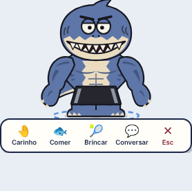
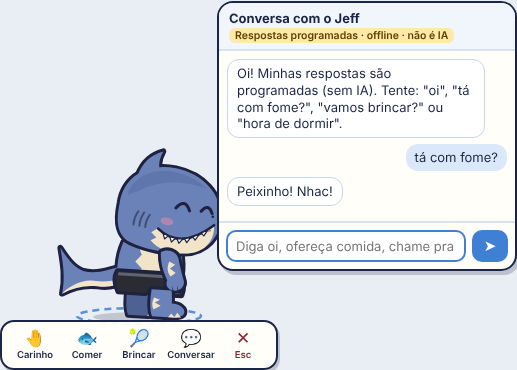

# Jeff Companion

Companion de desktop para **Windows 11** inspirado no Jeff, o Tubarão Terrestre.
**Projeto de fã, não oficial, sem vínculo com a Marvel ou a Disney.**

O Jeff fica sobre as janelas, com fundo transparente, passeia, descansa, dorme e
fala em balões de quadrinhos. Ele **sai do caminho quando o mouse se aproxima** e,
fora do modo de interação, **todos os cliques atravessam o Jeff** e chegam ao
aplicativo que está atrás.

> Arte atual: desenho vetorial articulado **provisório** (ver `assets/README.md`).

 

## Instalação (Windows)

**Só o `JeffCompanion.exe`**: é um executável portátil único. Basta abrir — não
precisa instalar nada (nem Node, nem runtime, nem permissão de administrador). As
configurações ficam em `%APPDATA%\Jeff Companion`.

Onde baixar: aba **Actions** do repositório → execução mais recente de *Jeff
Companion (Windows)* → artefato `JeffCompanion-windows-x64` → `JeffCompanion.exe`.

Alternativas no mesmo artefato: `JeffCompanion-Setup-<versão>.exe` (instala por
usuário, com atalho no menu Iniciar) ou `JeffCompanion-<versão>-win-x64.zip`.
O portátil leva alguns segundos a mais para abrir (ele se descompacta a cada início).

Opção B — gerar localmente (Windows, Node.js 22+):

```powershell
cd jeff-companion
npm ci
npx electron-builder --win --x64     # gera dist\JeffCompanion.exe, dist\JeffCompanion-Setup-*.exe e dist\*.zip
```

O executável não é assinado digitalmente; o SmartScreen pode pedir confirmação
("Mais informações" → "Executar assim mesmo").

## Executar em modo de desenvolvimento

```bash
cd jeff-companion
npm ci
npm start
```

## Controles

| Ação | Como |
|---|---|
| Modo de interação | **Ctrl + Alt + J** (configurável) ou ícone da bandeja → *Modo de interação* |
| Sair do modo de interação | **Esc**, botão ✕, clicar fora do Jeff ou inatividade (45 s por padrão) |
| Carinho | No modo de interação: passe o mouse esfregando sobre o Jeff ou use 🤚 |
| Abrir a Central do JoJo | Clique no pet (modo de interação) ou bandeja → *Abrir JoJo* |
| Ver atividades | Balão de status ao lado do pet; clique numa atividade (modo de interação) para abrir a conversa |
| Guardar/acordar o pet | `/pet` no chat, *Wake Pet / Tuck Away Pet* no menu "/", na Central ou nas Configurações |
| Comer / Brincar | Botões 🐟 e 🎾 |
| Arrastar | Clique e arraste o Jeff no modo de interação |
| Conversar | Botão 💬 (respostas **programadas**, offline — não é IA) |
| Mostrar/ocultar, pausar, silencioso, configurações, encerrar | Menu do ícone na bandeja |

Fora do modo de interação o Jeff não recebe cliques: ele foge do cursor e os
cliques passam para a janela de trás, mesmo durante a animação de fuga.

## Perguntas e emoções

- **Perguntas sem resposta programada**: o JoJo pesquisa na Wikipédia (ou no
  DuckDuckGo), resume em até 3 frases e responde no jeito dele (abertura e fecho
  seguem o perfil: palavrões, humor), citando a fonte. Sem internet, ele avisa e
  a conversa fica como *Bloqueado*. Pedidos contra as diretrizes (ex.: como usar
  drogas, dieta extrema) não são pesquisados.
- **85 animações**: as mais comuns (parado, andando, falando, alegria, julgamento,
  bronca, raiva) têm 4 variações sorteadas; as demais, 2–3.
- **Cor por emoção**: raiva deixa o JoJo avermelhado, tristeza acinzentado, medo
  pálido, alegria mais vivo, sono mais escuro, vergonha rosado. Xingar o JoJo
  deixa ele com raiva; rejeitar, triste; Instagram 3 vezes em 20 min, raiva.

## Pet, atividades e Central

O balão de status ao lado do pet mostra o andamento de cada conversa:
**Em andamento**, **Precisa de você**, **Pronto** (concluída, ainda não vista) e
**Bloqueado** (falha ou erro de sistema). Clicar no pet traz a **Central do JoJo**
para frente; clicar numa atividade abre aquela conversa. Comandos no chat:
`/pet` (Wake Pet / Tuck Away Pet), `/silencio`, `/nova`, `/config`. As conversas
ficam só na memória durante a sessão. Com "Efeitos de animação" desligado no
Windows (ou *Reduzir movimento* ligado), o pet usa quadros estáticos.

## Configurações

Tamanho, monitor preferido e troca de monitor, área de segurança do cursor
(100 px lógicos por padrão), velocidade, atividade, frequência e tamanho dos
balões, modo silencioso, sons (desligados por padrão), atalho, tempo de saída
automática, iniciar com o Windows (desligado por padrão), comportamento em tela
cheia (ocultar/pausar/nada), reduzir movimento (segue o Windows por padrão) e
restaurar padrões.

Arquivo: `%APPDATA%\Jeff Companion\settings.json` (formato versionado; arquivos
inválidos são preservados como `settings.invalid-<data>.json` e substituídos por
padrões). Log local: `%APPDATA%\Jeff Companion\logs\jeff.log`.

## Personalidade

O companion se chama **JoJo** (configurável); ele chama a usuária de **Emanuele**
quando o assunto é sério e de **Manu** quando é brincadeira, e cada fala vem com
a expressão corporal correspondente. Se ela disser que está chorando ou muito
triste, o JoJo diz para falar com o **João**, que sabe cuidar dela.

O jeito dele fica num **perfil separado** da aparência
(`%APPDATA%\Jeff Companion\personality.json`), editável em Configurações →
Personalidade: como ele te chama, palavrões (nenhum/ocasionais/frequentes),
humor ácido com referências a cocaína (sem incentivar uso; desligável), bronca ao
abrir o Instagram (intervalo mínimo, padrão 2 min), lembrete diário para comer com
atenção (horário aleatório, padrão 10h–21h) e instruções livres para uma IA futura.
Padrão: sério, mandão, humor seco e ácido. Respeita o modo silencioso e a pausa;
na conversa, "silêncio" liga o modo silencioso.

## Privacidade

Funciona offline. Não captura a tela, não usa microfone, não registra teclas,
cliques ou histórico, e não envia dados — com uma exceção, desligável em
Configurações: quando você faz uma **pergunta de conhecimento** que as respostas
programadas não cobrem ("o que é…", "quem foi…", "qual…"), só o texto dessa
pergunta é enviado à Wikipédia (e, se ela não tiver nada, ao DuckDuckGo) para o
JoJo responder. Conversa comum nunca acessa a rede. O cursor é consultado apenas
para calcular a distância até o Jeff. A detecção de tela cheia usa o estado do
shell e o retângulo/classe da janela em primeiro plano. O fiscal do Instagram
(Windows) compara o **título da janela em primeiro plano** e o nome do executável
com "Instagram" dentro de um processo isolado; só um sim/não sai dele, nada é
guardado. Pode ser desligado nas configurações.

## Testes e build

```bash
npm test                 # unitários e simulação (Node, qualquer SO)
npm run test:e2e         # Electron real via Playwright (Linux usa Xvfb automaticamente)
node --test test/e2e/windows.e2e.mjs   # integração com mouse/teclado reais (só Windows)
node scripts/measure.mjs # CPU e memória
npm run build:win        # pacote Windows (no Linux requer wine + wine32)
npx electron scripts/preview-sheet.mjs docs/animation-sheet.png   # folha de animações
npx electron scripts/make-icons.mjs                                # regenera ícones
```

O workflow `.github/workflows/jeff-windows.yml` roda tudo isso em `windows-latest`.

## Limitações conhecidas

- Arte provisória (vetorial articulada feita à mão); falta arte final.
- Jogos em tela cheia **exclusiva** e telas protegidas do Windows (UAC, tela de
  bloqueio, Ctrl+Alt+Del) ficam acima do Jeff; isso não é contornável sem injeção, que não usamos.
- A barra de tarefas pode passar à frente do Jeff momentaneamente; o app reafirma
  "sempre por cima" a cada 8 s.
- Consumo de memória típico de Electron (centenas de MB somando processos).
- Detalhes do que foi e não foi verificado no Windows: `HANDOFF.md`.
